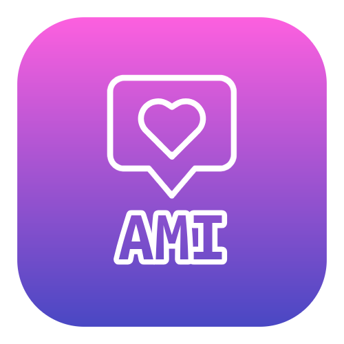

<p align="center">
  
</p>

# Amiga IA - Autonomous Agentic Suite & Declarative Skills

[English](README.md) | [Español](README.es.md)

[](https://www.npmjs.com/package/@anacatavc/amiga-ia)
[](https://deepmind.google/technologies/gemini/)
[](https://anthropic.com/)
[](https://openai.com/codex/)
[](LICENSE)

> 🎶 Inspiración del nombre: [Amiga Mía - Los Prisioneros](https://www.youtube.com/watch?v=qPHaLk4-_Ew)  
> 🌐 Página web del producto: [amiga-ia.ana-catalina.com](https://amiga-ia.ana-catalina.com/)

---


### 1. Descripción del Proyecto
**Amiga IA** es un ecosistema integral de *subagentes autónomos*, *hooks de seguridad sin estado* y *skills declarativas portátiles* diseñado para transformar a los asistentes de código por inteligencia artificial de simples ejecutores pasivos a colaboradores proactivos. Desarrollado para **Antigravity (Gemini)**, **Claude Code** y **OpenAI Codex**, Amiga IA ofrece una única fuente de verdad para la gestión escalable de capacidades bajo el estándar de **Agent Skills (Markdown + Carga Diferida / Lazy Loading)**.

A lo largo de su evolución arquitectónica desde **v3.0.0 ("The Agentic Evolution")** hasta **v5.6.0**, Amiga IA proporciona orquestación multi-habilidad descentralizada, TDD Cleanroom (Doble Ciego) con `ami-cleanroom-arbiter`, distribución nativa para el tri-ecosistema y una suite autónoma de prototipado ágil de UI y auditoría de consistencia de tokens de diseño (`ami-ui-builder`, `ami-prototype-ui`, `ami-audit-ui-consistency`) sin depender de supervisión humana constante ni instrucciones paso a paso.

### 2. Tecnologías e Innovaciones Arquitectónicas
* **Agent Skills (XML + Carga Diferida / Lazy Loading):** Arquitectura optimizada para el ahorro de tokens donde un índice con el catálogo de herramientas se inyecta en el prompt base, permitiendo al LLM abrir y leer el archivo Markdown de instrucciones solo cuando necesita usar una habilidad específica.
* **Orquestación Multi-Habilidad en Paralelo (ADR-002):** Perfiles de subagente descentralizados (como `ami-pr-reviewer`, `ami-doc-architect` y `ami-repo-auditor`) coordinan flujos de trabajo concurrentes para inspeccionar deuda técnica, validar coherencia antes de un push y revisar PRs en simultáneo.
* **Tríada de TDD Cleanroom (Doble Ciego, ADR-012, ADR-017):** Subagentes desacoplados para implementación (`ami-cleanroom-builder`) y pruebas de QA (`ami-cleanroom-tester`) arbitrados por `ami-cleanroom-arbiter` sobre contratos de interfaz formales congelados (`docs/contracts/`), eliminando el sobreajuste y el sesgo de confirmación.
* **Distribución Tri-Ecosistema y Compilador Semántico (ADR-014, ADR-015, ADR-016):** Traduce fuentes canónicas en Markdown hacia formatos nativos en Anthropic Claude Code (`~/.claude/`), Google Antigravity (`~/.gemini/config/`) y OpenAI Codex (`~/.agents/` y `~/.codex/`), compilando manifiestos TOML nativos para subagentes y resolviendo dinámicamente rutas mediante interpolación (`__AMIGA_CODEX_SKILLS_DIR__`).
* **Revisión Dual de Código y Falsificación Adversarial (ADR-006, ADR-013):** Auditoría adversarial proactiva (`ami-adversarial-verifier`) que evalúa Pull Requests mediante modos duales (Revisión Estática de Código vs. Revisión Dinámica Completa con ejecución de pruebas) y sondeos de 5 dimensiones para erradicar falsos positivos.
* **Prototipado Autónomo de UI y Auditoría de Consistencia (ADR-018):** Desacopla el marcado visual derivándolo a `ami-ui-builder`, generando especificaciones vivas autocontenidas en HTML5 y Tailwind CSS (`docs/mockups/`) y auditando el cumplimiento de tokens de diseño en Web, Desktop y Mobile.
* **Ejecución Ligera Sin Estado (Zero-Overhead, ADR-003):** Los hooks en segundo plano están optimizados para la economía de tokens y cero contaminación del contexto de memoria, ejecutándose con fluidez mediante Bash, PowerShell nativo de Windows o scripts de Node.js sin dependencias externas.
* **Optimización del Prompt del Sistema y Hooks Unificados (ADR-004):** Refactorización del adaptador universal hacia atributos XML compactos con ruta raíz relativa, y migración de comandos en línea de PowerShell y Bash a scripts externos de tiempo de ejecución (`hooks/scripts/ami-hooks.ps1` y `ami-hooks.sh`). Esto logró una reducción verificada del **36.3% (-1,211 tokens por turno)** en la sobrecarga recurrente del Prompt del Sistema (cayendo de 3,335 a 2,124 tokens/turno), acelerando la inferencia del modelo y eliminando errores de duplicidad en terminal.
* **Asistente CLI Interactivo (`amiga-ia-setup`):** Herramienta desarrollada en Node.js que instala habilidades, realiza fusiones (*merge*) seguras con la configuración local de tus asistentes de IA, purga automáticamente sistemas heredados y audita la salud general del entorno.

### 3. Aprendizajes Clave (Key Learnings)
El desarrollo y evolución iterativa de Amiga IA hacia un ecosistema plenamente agéntico proporcionó valiosas lecciones de ingeniería de software e inteligencia artificial:
* **IA Agéntica vs. Prompts Pasivos:** Las instrucciones imperativas paso a paso tienden a romperse a medida que las bases de código crecen. Migrar hacia subagentes autónomos que razonan sobre objetivos globales, exploran el repositorio y coordinan revisiones en paralelo demostró ser exponencialmente más resistente, preciso y escalable que la ingeniería de prompts tradicional.
* **Aislamiento Cleanroom vs. Sesgo de Confirmación:** La generación de pruebas por un único agente sufre inevitablemente de sesgo de confirmación: el mismo modelo que escribe el código escribe pruebas sesgadas por sus propias asunciones. Desacoplar el flujo en subagentes aislados que se comunican estrictamente mediante contratos de interfaz inmutables (Cleanroom TDD) reveló ambigüedades de diseño y casos borde antes de tocar producción.
* **Economía de Tokens y Arquitectura Sin Estado:** Las primeras versiones del proyecto dependían de cachés obligatorias para persistir resúmenes locales de sesión. El análisis continuo demostró que arrastrar este contexto acumulado en cada inicio degradaba la velocidad de respuesta del modelo y elevaba innecesariamente el consumo de tokens. La retirada radical del estado de sesión en favor de inspecciones reactivas en tiempo real (ADR-003) devolvió al sistema su agilidad e inmediatez.
* **Mitigación de la Sobrecarga Silenciosa de Tokens:** Los catálogos dinámicos inyectados en el Prompt del Sistema generan un costo acumulativo severo durante sesiones largas. El reemplazo de etiquetas XML anidadas y extensas por índices relativos basados en atributos compactos erradicó el desperdicio redundante en memoria (ADR-004). Además, sustituir comandos en línea complejos por llamados a scripts externos estandarizados evitó fallos en la deduplicación de cadenas entre diferentes sistemas operativos.
* **Resolución de Rutas Multiplataforma y Neutralización de Entorno:** Distribuir habilidades declarativas en diferentes entornos requiere una normalización estricta de rutas. Las rutas absolutas en paquetes compartidos generan colisiones; abstraer carpetas locales en variables de interpolación resolvió disparidades entre sistemas de archivos Windows/Linux y evitó efectos secundarios con caracteres especiales durante la instalación.
* **Universalidad Multi-Ecosistema:** Lograr 100% de compatibilidad operativa entre motores con arquitecturas distintas (Antigravity de Google, Claude Code de Anthropic y OpenAI Codex) en múltiples sistemas operativos requirió encapsular la lógica de interdicción en wrappers transversales y normalizar la traducción de capacidades hacia sus formatos nativos.

### 4. Estructura del Repositorio
```text
amiga-ia/
├── package.json             # Registro del paquete NPM y Fuente Única de Verdad
├── agent/                   # Punto de entrada base para librerías del agente (agent.js)
├── adapters/                # Compilador del índice XML universal (universal_adapter.js)
├── agents/                  # Perfiles de Subagentes Autónomos en Markdown (ami-*.md)
├── docs/                    # Memoria persistente y árbol de documentación del proyecto
│   ├── adr/                 # Registros de Decisiones Arquitectónicas (ADRs)
│   ├── architecture/        # Guías técnicas de ingeniería (ej. universal adapter)
│   └── learning/            # Lecciones de sesión capturadas y patrones iterativos
├── skills/                  # Skills canónicas en Markdown (ami-*/SKILL.md)
├── codex/                   # Archivos nativos de Codex generados para el instalador
├── hooks/                   # Hooks de seguridad nativos y scripts multiplataforma
│   ├── hooks.json           # Copia generada de hooks.json (npm run build)
│   └── scripts/             # Scripts externos universales (.js, ami-hooks.ps1 y ami-hooks.sh)
├── hooks.json               # Configuración nativa de hooks de Claude Code (Motor Bash)
└── hooks-pwsh.json          # Configuración nativa de hooks de Claude Code (Motor PowerShell)
```

### 5. Skills y Agentes Incluidos

Todas las capacidades incluidas emplean de forma estricta el prefijo de espacio de nombres **`ami-`** para prevenir colisiones en el ecosistema.

| Tipo | Nombre | Descripción |
|---|---|---|
| Agente | **ami-adversarial-verifier** | Verificador adversarial en contexto fresco que audita diffs de código y contratos para detectar casos borde, vulnerabilidades y llamadas rotas sin sesgo del autor. |
| Agente | **ami-cleanroom-arbiter** | Árbitro y orquestador maestro de Cleanroom TDD (Doble Ciego). Congela contratos formales de interfaz, despacha subagentes aislados de construcción y testing, ejecuta suites de prueba y arbitra fallos. |
| Agente | **ami-cleanroom-builder** | Implementador de código de producción para flujos Cleanroom TDD. Programa respetando estrictamente los contratos de interfaz sin sobreajustarse a los tests. |
| Agente | **ami-cleanroom-tester** | Arquitecto de pruebas de caja negra independiente para Cleanroom TDD. Genera suites exhaustivas a partir de contratos y criterios de aceptación, aislado del código fuente. |
| Agente | **ami-data-scientist** | Agente maestro de la Suite de Datos y SQL. Orquesta análisis exploratorio y auditoría de sesgos integrados, optimización de consultas en base de datos y dashboards ejecutivos. |
| Agente | **ami-doc-architect** | Agente maestro de documentación y ciclo de vida del conocimiento. Orquesta en paralelo wikis, auditorías de obsolescencia, investigación y lecciones. |
| Agente | **ami-expert-council** | Convoca una mesa redonda de subagentes especializados para debatir, analizar y refinar una idea o decisión arquitectónica desde múltiples perspectivas. |
| Agente | **ami-pr-publisher** | Agente maestro que ejecuta revisiones integrales, redacción de resúmenes ejecutivos y verificación de conflictos antes de publicar un Pull Request. |
| Agente | **ami-pr-reviewer** | Orquestador maestro que evalúa Pull Requests mediante modos duales (Revisión Estática vs Revisión Completa con ejecución de tests), ingesta de contexto y pistas de auditoría adversarial. |
| Agente | **ami-push-assistant** | Orquestador pre-push que ejecuta auditorías de calidad, escaneo de fugas de secretos y coherencia estructural antes de enviar código al remoto. |
| Agente | **ami-release-manager** | Orquestador central del ciclo de lanzamientos que calcula versiones semánticas, redacta changelogs bilingües y publica el release oficial en GitHub. |
| Agente | **ami-repo-auditor** | Agente maestro de auditoría que evalúa concurrentemente deuda técnica, higiene de librerías y vulnerabilidades en todo el código base. |
| Agente | **ami-tech-lead** | Agente maestro de planificación y arquitectura. Evalúa la salud del repositorio, planifica nuevas características y guía decisiones técnicas. |
| Agente | **ami-ui-builder** | Especialista maestro en UI y prototipado. Construye mockups interactivos en HTML5/Tailwind, prototipos de interfaz, páginas web y documentación visual sin saturar la ventana de contexto principal. |
| Skill | **ami-analyze-dependencies** | Audita las librerías del proyecto para identificar paquetes sin uso, versiones obsoletas, vulnerabilidades o dependencias fantasma. |
| Skill | **ami-analyze-pr-comments** | Procesa observaciones de revisión de código dejadas por compañeros de equipo en PRs activos, estructurando tareas pendientes y borradores de respuesta. |
| Skill | **ami-architect-project** | Construye de forma interactiva la arquitectura base de un nuevo proyecto, stack tecnológico, árbol de directorios y un README inicial bilingüe. |
| Skill | **ami-audit-quality** | Audita los archivos modificados verificando legibilidad, diseño modular, principios DRY, seguridad, consistencia de esquemas de datos y buenas prácticas del framework. |
| Skill | **ami-audit-ui-consistency** | Audita interfaces en plataformas web, desktop y mobile para garantizar cumplimiento de tokens de diseño, jerarquía de botones, estados estándar y ausencia de iconos duplicados o colisiones semánticas. |
| Skill | **ami-build-dashboard** | Construye dashboards web interactivos y visualizaciones profesionales en Python a partir de conjuntos de datos y KPIs. |
| Skill | **ami-create-tests** | Se ejecuta automáticamente cuando se incorpora código nuevo sin pruebas unitarias. Crea tests enfocados en proteger las nuevas funciones. |
| Skill | **ami-debug-issue** | Ejecuta un protocolo de depuración científica basado en evidencias, aislando causas raíz sin conjeturas y escribiendo pruebas automáticas. |
| Skill | **ami-design-test-strategy** | Se ejecuta antes de programar tests. Diseña estrategias generales de QA, piramidación de pruebas, políticas de mocking y puertas de calidad en CI. |
| Skill | **ami-detect-pr-conflicts** | Se ejecuta antes de revisar o abrir un PR. Identifica colisiones en historiales de Git y posibles conflictos de merge entre ramas paralelas. |
| Skill | **ami-manage-docs** | Gestor integral de documentación y conocimiento. Detecta si debe crear documentos, sincronizar wikis con Git, depurar notas obsoletas o extraer lecciones de sesión y ADRs. |
| Skill | **ami-optimize-sql** | Redacta y optimiza SQL multinivel (PostgreSQL, BigQuery, Snowflake, etc.), elimina anti-patrones y recomienda índices eficaces. |
| Skill | **ami-orchestrate-cleanroom** | Orquestador maestro de TDD Cleanroom (Doble Ciego). Aclara interactivamente dudas de interfaz y sugerencias, congela contratos, despacha subagentes aislados de código y testing, ejecuta pruebas y arbitra discrepancias. |
| Skill | **ami-plan-commits** | Analiza el árbol de trabajo actual, audita seguridad/secretos, planifica Conventional Commits/amend/squash y ejecuta las transacciones en Git. |
| Skill | **ami-plan-feature** | Flujo interactivo de planificación de características y orquestación de arquitectura. Aclara dudas y propone alternativas técnicas con el usuario antes de investigar y redactar planes. |
| Skill | **ami-prepare-release** | Prepara lanzamientos en GitHub calculando la siguiente etiqueta semántica y redactando notas de versión bilingües (inglés y español) en un flujo unificado. |
| Skill | **ami-prototype-ui** | Construye mockups y prototipos interactivos autocontenidos en HTML5 y Tailwind CSS para validación rápida de vistas sin dependencias de compilación. |
| Skill | **ami-research-context** | Investiga documentación externa actualizada en tiempo real y guarda hallazgos en referencias para evitar la obsolescencia de contexto. |
| Skill | **ami-review-peer-pr** | Conduce revisiones en PRs de terceros con trazabilidad de criterios de aceptación, modos duales y auditoría de falsificación adversarial ([Falsification Check]) para eliminar falsos positivos. |
| Skill | **ami-review-self-pr** | Actúa como un exigente Ingeniero Senior revisando tu propio código mediante modos duales, sondeos adversariales de 5 dimensiones ([Blind-Spot Probe]) y bucles de remediación local de tests. |
| Skill | **ami-scan-tech-debt** | Escanea el repositorio buscando deuda técnica, módulos obsoletos, lógica duplicada, código muerto y marcadores pendientes (TODOs/FIXMEs). |
| Skill | **ami-stress-test-idea** | Ejecuta pruebas de estrés adversariales y análisis premortem en propuestas técnicas, detectando SPOFs, fallos de concurrencia y costos ocultos. |

### 6. Instalación y Uso
El método oficial y recomendado para integrar **Amiga IA** es mediante la instalación del paquete global de NPM:

```bash
npm install -g @anacatavc/amiga-ia
```

**Asistente Interactivo de Configuración (CLI):**
Ejecuta el asistente CLI para elegir tus entornos de IA activos (Antigravity, Claude Code y/o OpenAI Codex) y configurar los motores de hooks compatibles:
```bash
amiga-ia-setup
```

**Herramienta de Diagnóstico del Sistema (`doctor`):**
Para verificar la salud y permisos del sistema, consultar incompatibilidades del sistema operativo y validar que la sintaxis YAML frontmatter sea 100% correcta:
```bash
amiga-ia-setup doctor
```

> 💡 **Hooks de Seguridad y Selección de Motor:** Claude Code es compatible con recordatorios de pre-commit y bloqueos de seguridad. El asistente CLI fusiona limpiamente estas reglas ligeras en `~/.claude/settings.json`, generando un respaldo de seguridad en `~/.claude/settings.json.amiga-backup`. Google Antigravity ejecuta estas directrices nativamente mediante su pipeline atómico y el archivo de reglas `rules/ami-rules.md`. OpenAI Codex soporta hooks no bloqueantes en `~/.codex/hooks.json`.

#### 6.1 Directorios Globales Instalados
Al ejecutar `amiga-ia-setup`, el asistente estructura de forma segura las siguientes carpetas en el usuario raíz del sistema:

```text
~/.claude/                          # Configuración Global de Claude Code
├── skills/ami-*/SKILL.md           # Skills Declarativas (22 directorios)
├── agents/ami-*.md                 # Subagentes Autónomos (14 perfiles)
├── settings.json                   # Hooks Fusionados (PreToolUse, PostToolUse)
└── settings.json.amiga-backup      # Respaldo intacto del archivo original de usuario

~/.gemini/config/                   # Configuración Global de Antigravity (Gemini)
├── skills/ami-*/SKILL.md           # Skills Declarativas (22 directorios)
├── agents/ami-*.md                 # Subagentes Autónomos (14 perfiles)
└── rules/ami-rules.md              # Reglas Operativas Declarativas

~/.agents/skills/                   # Skills Globales de Codex (22 directorios)
~/.codex/                           # Configuración Global de Codex
├── agents/ami-*.toml               # Subagentes en formato TOML (14 perfiles)
├── AGENTS.md                       # Reglas de Comportamiento Fusionadas (Opcional)
└── hooks.json                      # Hooks opcionales de ciclo de vida
```

### 7. Desinstalación
Para retirar limpiamente Amiga IA y devolver tu configuración al estado original:
1. Ejecuta `amiga-ia-setup` y selecciona la opción `u` (Uninstall) para eliminar en segundos todas las habilidades, subagentes, reglas y hooks fusionados.
2. Ejecuta `npm uninstall -g @anacatavc/amiga-ia` para retirar el paquete del sistema.

### 8. Extendiendo el Ecosistema
* **Convención Obligatoria (Prefijo `ami-`):** Toda habilidad o subagente personalizado DEBE llevar el prefijo de espacio de nombres `ami-` (ej. `ami-devops-checker`). Esto preserva el orden e impide choques con terceros.
* **Agregar una Nueva Skill:** Construye un directorio en `skills/ami-<nombre>/` que contenga un archivo `SKILL.md` estructurado con cabecera YAML frontmatter y cuerpo en Markdown.
* **Agregar un Nuevo Agente:** Crea un perfil de subagente autónomo en `agents/ami-<nombre>.md` detallando su personalidad, herramientas autorizadas y estrategias de delegación.

---

## Licencia

Este proyecto está bajo la Licencia MIT. Consulta el archivo [LICENSE](LICENSE) para más detalles.

