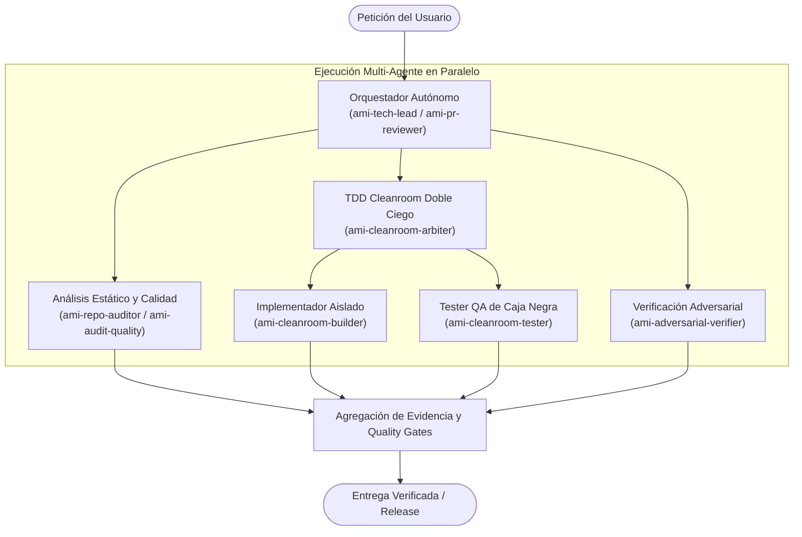

<p align="center">
  
</p>

# Amiga IA - Autonomous Agentic Suite & Declarative Skills

[English](README.md) | [Español](README.es.md)

[](https://www.npmjs.com/package/@anacatavc/amiga-ia)
[](https://deepmind.google/technologies/gemini/)
[](https://anthropic.com/)
[](https://openai.com/codex/)
[](benchmarks/README.md)
[](LICENSE)

> 🎶 Inspiración del nombre: [Amiga Mía - Los Prisioneros](https://www.youtube.com/watch?v=qPHaLk4-_Ew)  
> 🌐 Página web del producto: [amiga-ia.ana-catalina.com](https://amiga-ia.ana-catalina.com/)

---

### 1. Descripción del Proyecto
**Amiga IA** es un ecosistema integral de *subagentes autónomos*, *hooks de seguridad sin estado* y *skills declarativas portátiles* diseñado para transformar a los asistentes de código por inteligencia artificial de simples ejecutores pasivos a colaboradores proactivos. Desarrollado para **Antigravity (Gemini)**, **Claude Code** y **OpenAI Codex**, Amiga IA ofrece una única fuente de verdad para la gestión escalable de capacidades bajo el estándar de **Agent Skills (Markdown + Carga Diferida / Lazy Loading)**.

A lo largo de su evolución arquitectónica desde **v3.0.0 ("The Agentic Evolution")** hasta **v5.7.0**, Amiga IA proporciona orquestación multi-habilidad descentralizada, TDD Cleanroom (Doble Ciego) con `ami-cleanroom-arbiter`, distribución nativa para el tri-ecosistema y una suite autónoma de prototipado ágil de UI y auditoría de consistencia de tokens de diseño (`ami-ui-builder`, `ami-prototype-ui`, `ami-audit-ui-consistency`) sin depender de supervisión humana constante ni instrucciones paso a paso.

#### 1.1 Flujo Autónomo End-to-End
En lugar de depender de prompts paso a paso guiados manualmente, Amiga IA coordina equipos descentralizados de subagentes mediante contratos formales y arbitraje automatizado:



### 2. Compilación, Instalación y Quickstart
El método oficial y recomendado es instalar Amiga IA de forma global mediante el registro de paquetes de NPM:

```bash
# 1. Instalar globalmente desde el registro de NPM
npm install -g @anacatavc/amiga-ia

# 2. Iniciar el asistente interactivo de configuración CLI
amiga-ia-setup

# 3. Comprobar la salud del entorno y la integridad de esquemas
amiga-ia-setup doctor
```

> 💡 **Hooks Multi-Motor y Guardrails:** Claude Code admite recordatorios preventivos y bloqueos de seguridad que se integran limpiamente en `~/.claude/settings.json` (con respaldo automático en `~/.claude/settings.json.amiga-backup`). Google Antigravity ejecuta de forma nativa su pipeline de planificación atómica y reglas declarativas vía `rules/ami-rules.md`. OpenAI Codex admite hooks de ciclo de vida no bloqueantes en `~/.codex/hooks.json`.

#### 2.1 Directorios Multi-Ecosistema Configurados
Al ejecutar `amiga-ia-setup`, el asistente estructura de forma segura las siguientes configuraciones en el directorio de usuario:

```text
~/.claude/                          # Configuración Global de Claude Code
├── skills/ami-*/SKILL.md           # Skills declarativas (23 directorios)
├── agents/ami-*.md                 # Subagentes autónomos (14 perfiles)
├── settings.json                   # Hooks fusionados (PreToolUse, PostToolUse)
└── settings.json.amiga-backup      # Copia de seguridad original de settings

~/.gemini/config/                   # Configuración Global de Antigravity (Gemini)
├── skills/ami-*/SKILL.md           # Skills declarativas (23 directorios)
├── agents/ami-*.md                 # Subagentes autónomos (14 perfiles)
└── rules/ami-rules.md              # Reglas operativas declarativas

~/.agents/skills/                   # Skills Globales de Codex (23 directorios)
~/.codex/                           # Configuración Global de Codex
├── agents/ami-*.toml               # Subagentes en formato TOML (14 perfiles)
├── AGENTS.md                       # Reglas de comportamiento (Opcional)
└── hooks.json                      # Hooks opcionales de ciclo de vida
```

#### 2.2 Desinstalación
Para retirar limpiamente Amiga IA y devolver tu configuración al estado original:
1. Ejecuta `amiga-ia-setup` y selecciona la opción `u` (Uninstall) para eliminar en segundos todas las habilidades, subagentes, reglas y hooks fusionados.
2. Ejecuta `npm uninstall -g @anacatavc/amiga-ia` para desinstalar el paquete global de tu sistema.

### 3. Tecnologías e Innovaciones Arquitectónicas
* **Agent Skills (XML + Carga Diferida / Lazy Loading):** Arquitectura optimizada para el ahorro de tokens donde un índice con el catálogo de herramientas se inyecta en el prompt base, permitiendo al LLM abrir y leer el archivo Markdown de instrucciones solo cuando necesita usar una habilidad específica.
* **Orquestación Multi-Habilidad en Paralelo (ADR-002):** Perfiles de subagente descentralizados (como `ami-pr-reviewer`, `ami-doc-architect` y `ami-repo-auditor`) coordinan flujos de trabajo concurrentes para inspeccionar deuda técnica, validar coherencia antes de un push y revisar PRs en simultáneo.
* **Tríada de TDD Cleanroom (Doble Ciego, ADR-012, ADR-017):** Subagentes desacoplados para implementación (`ami-cleanroom-builder`) y pruebas de QA (`ami-cleanroom-tester`) arbitrados por `ami-cleanroom-arbiter` sobre contratos de interfaz formales congelados (`docs/contracts/`), eliminando el sobreajuste y el sesgo de confirmación.
* **Distribución Tri-Ecosistema y Compilador Semántico (ADR-014, ADR-015, ADR-016):** Traduce fuentes canónicas en Markdown hacia formatos nativos en Anthropic Claude Code (`~/.claude/`), Google Antigravity (`~/.gemini/config/`) y OpenAI Codex (`~/.agents/` y `~/.codex/`), compilando manifiestos TOML nativos para subagentes y resolviendo dinámicamente rutas mediante interpolación (`__AMIGA_CODEX_SKILLS_DIR__`).
* **Revisión Dual de Código y Falsificación Adversarial (ADR-006, ADR-013):** Auditoría adversarial proactiva (`ami-adversarial-verifier`) que evalúa Pull Requests mediante modos duales (Revisión Estática de Código vs. Revisión Dinámica Completa con ejecución de pruebas) y sondeos de 5 dimensiones para erradicar falsos positivos.
* **Prototipado Autónomo de UI y Auditoría de Consistencia (ADR-018):** Desacopla el marcado visual derivándolo a `ami-ui-builder`, generando especificaciones vivas autocontenidas en HTML5 y Tailwind CSS (`docs/mockups/`) y auditando el cumplimiento de tokens de diseño en Web, Desktop y Mobile.
* **Ejecución Ligera Sin Estado (Zero-Overhead, ADR-003):** Los hooks en segundo plano están optimizados para la economía de tokens y cero contaminación del contexto de memoria, ejecutándose con fluidez mediante Bash, PowerShell nativo de Windows o scripts de Node.js sin dependencias externas.
* **Optimización del Prompt del Sistema y Hooks Unificados (ADR-004):** Refactorización del adaptador universal hacia atributos XML compactos con ruta raíz relativa, y migración de comandos en línea de PowerShell y Bash a scripts externos de tiempo de ejecución (`hooks/scripts/ami-hooks.ps1` y `ami-hooks.sh`). Esto logró una reducción verificada del **36.3% (-1,211 tokens por turno)** en la sobrecarga recurrente del Prompt del Sistema (cayendo de 3,335 a 2,124 tokens/turno), acelerando la inferencia del modelo y eliminando errores de duplicidad en terminal.
* **Asistente CLI Interactivo (`amiga-ia-setup`):** Herramienta desarrollada en Node.js que instala habilidades, realiza fusiones (*merge*) seguras con la configuración local de tus asistentes de IA, purga automáticamente sistemas heredados y audita la salud general del entorno.

### 4. Benchmarks Empíricos y Verificación
Amiga IA valida sus principales afirmaciones arquitectónicas mediante una suite de benchmarks agénticos 100% determinista y offline (`benchmarks/`):

```bash
# Ejecutar la suite completa de benchmarks agénticos
npm run benchmark

# Ejecutar benchmarks individuales
npm run benchmark:tokens    # Valida la reducción del 44.75% de contexto (ADR-004)
npm run benchmark:audit     # Valida la detección de defectos (100% precisión y recall)
npm run benchmark:cleanroom # Valida TDD Cleanroom (0% sesgo de confirmación)
```

| Experimento de Benchmark | Foco / Afirmación | Resultado Empírico | Quality Gate | Estado |
|---|---|---|---|---|
| **Sobrecarga de Tokens del Sistema** | Reducción de huella por turno (ADR-004) | **-2.973 tokens ahorrados (-44.75%)** | $\ge 35.0\%$ reducción | **PASSED** |
| **Auditoría de Repositorio** | Precisión, recall y resiliencia ante falsos positivos | **100% Precisión, 100% Recall ($F_1 = 1.00$)** | $F_1 \ge 0.85$ | **PASSED** |
| **Aislamiento Cleanroom TDD** | Sesgo de confirmación y defectos escapados (ADR-012) | **0% sesgo de confirmación, 0 defectos escapados** | 0 defectos escapados | **PASSED** |

> 📊 La metodología detallada, los contratos de evaluación y las métricas brutas están documentados en [benchmarks/README.md](benchmarks/README.md) y en el informe generado en [BENCHMARK_REPORT.md](benchmarks/results/BENCHMARK_REPORT.md).

### 5. Capacidades Insignia y Perfiles de Agente
Amiga IA comprende **37 capacidades integradas** (14 subagentes autónomos y 23 skills declarativas) utilizando estrictamente el prefijo de espacio de nombres `ami-` para evitar colisiones con otros ecosistemas.

La siguiente matriz destaca los **agentes y habilidades insignia** que encabezan los principales flujos de trabajo autónomos:

| Componente | Tipo | Rol Principal y Responsabilidad |
|---|---|---|
| **ami-cleanroom-arbiter** | Agente | Árbitro maestro de TDD Cleanroom. Congela contratos de interfaz formales (`docs/contracts/`), despacha agentes aislados de implementación y testing, ejecuta suites de prueba y adjudica fallos. |
| **ami-pr-reviewer** | Agente | Orquestador de revisión de PRs mediante modos duales (revisión estática vs revisión dinámica completa con pruebas) y auditorías de falsificación adversarial. |
| **ami-repo-auditor** | Agente | Orquestador maestro que evalúa concurrentemente deuda técnica, higiene de dependencias y vulnerabilidades de seguridad en todos los módulos. |
| **ami-tech-lead** | Agente | Orquestador maestro de arquitectura y planificación. Evalúa la salud del repositorio, planifica características y coordina planos arquitectónicos. |
| **ami-ui-builder** | Agente | Especialista maestro en UI, UX y prototipado de interfaces. Construye maquetas interactivas en HTML5 y Tailwind CSS y especificaciones vivas sin saturar el contexto principal. |
| **ami-push-assistant** | Agente | Asistente de pre-push que verifica la calidad de código, escanea secretos y tokens API en texto plano, y comprueba suites de tests antes de enviar cambios al repositorio remoto. |
| **ami-orchestrate-cleanroom** | Skill | Flujo de orquestación de TDD Cleanroom que coordina agentes aislados de implementación y diseño de pruebas de caja negra sobre contratos formales congelados. |
| **ami-review-self-pr** | Skill | Revisión exhaustiva de código propio con sondeos de 5 dimensiones (`[Blind-Spot Probe]`) y ciclos de remediación local automatizados. |
| **ami-audit-quality** | Skill | Inspección profunda de código evaluando mantenibilidad modular, fallos de seguridad, consistencia de esquemas y solidez estructural. |
| **ami-design-ux** | Skill | Arquitecto maestro de UX que diseña flujos de interacción, modelos mentales, los 5 estados esenciales y microcopy (`docs/ux/`). |
| **ami-prototype-ui** | Skill | Creación ágil de maquetas de UI y pantallas interactivas autocontenidas en HTML5 y Tailwind CSS (`docs/mockups/`). |

> 📚 **Catálogo Completo:** Para consultar la referencia exhaustiva, esquemas y la categorización por dominio de las 37 capacidades, consulta el [Catálogo Completo de Capacidades](docs/catalog.md) ([Español](docs/catalog.es.md)).

### 6. Aprendizajes Clave (Key Learnings)
El desarrollo y evolución iterativa de Amiga IA hacia un ecosistema plenamente agéntico proporcionó valiosas lecciones de ingeniería de software e inteligencia artificial:
* **IA Agéntica vs. Prompts Pasivos:** Las instrucciones imperativas paso a paso tienden a romperse a medida que las bases de código crecen. Migrar hacia subagentes autónomos que razonan sobre objetivos globales, exploran el repositorio y coordinan revisiones en paralelo demostró ser exponencialmente más resistente, preciso y escalable que la ingeniería de prompts tradicional.
* **Aislamiento Cleanroom vs. Sesgo de Confirmación:** La generación de pruebas por un único agente sufre inevitablemente de sesgo de confirmación: el mismo modelo que escribe el código escribe pruebas sesgadas por sus propias asunciones. Desacoplar el flujo en subagentes aislados que se comunican estrictamente mediante contratos de interfaz inmutables (Cleanroom TDD) reveló ambigüedades de diseño y casos borde antes de tocar producción.
* **Economía de Tokens y Arquitectura Sin Estado:** Las primeras versiones del proyecto dependían de cachés obligatorias para persistir resúmenes locales de sesión. El análisis continuo demostró que arrastrar este contexto acumulado en cada inicio degradaba la velocidad de respuesta del modelo y elevaba innecesariamente el consumo de tokens. La retirada radical del estado de sesión en favor de inspecciones reactivas en tiempo real (ADR-003) devolvió al sistema su agilidad e inmediatez.
* **Mitigación de la Sobrecarga Silenciosa de Tokens:** Los catálogos dinámicos inyectados en el Prompt del Sistema generan un costo acumulativo severo durante sesiones largas. El reemplazo de etiquetas XML anidadas y extensas por índices relativos basados en atributos compactos erradicó el desperdicio redundante en memoria (ADR-004). Además, sustituir comandos en línea complejos por llamados a scripts externos estandarizados evitó fallos en la deduplicación de cadenas entre diferentes sistemas operativos.
* **Resolución de Rutas Multiplataforma y Neutralización de Entorno:** Distribuir habilidades declarativas en diferentes entornos requiere una normalización estricta de rutas. Las rutas absolutas en paquetes compartidos generan colisiones; abstraer carpetas locales en variables de interpolación resolvió disparidades entre sistemas de archivos Windows/Linux y evitó efectos secundarios con caracteres especiales durante la instalación.
* **Universalidad Multi-Ecosistema:** Lograr 100% de compatibilidad operativa entre motores con arquitecturas distintas (Antigravity de Google, Claude Code de Anthropic y OpenAI Codex) en múltiples sistemas operativos requirió encapsular la lógica de interdicción en wrappers transversales y normalizar la traducción de capacidades hacia sus formatos nativos.

### 7. Estructura del Repositorio
```text
amiga-ia/
├── package.json             # Registro del paquete NPM y Fuente Única de Verdad
├── bin/setup.js             # Asistente CLI interactivo y herramienta de diagnóstico doctor
├── adapters/                # Compilador de catálogo XML universal (universal_adapter.js)
├── agents/                  # Perfiles de subagentes autónomos en Markdown (ami-*.md)
├── skills/                  # Skills declarativas canónicas en Markdown (ami-*/SKILL.md)
├── benchmarks/              # Suite de benchmarks agénticos y contratos de evaluación
│   ├── contracts/           # Contratos formales congelados para evaluación
│   ├── token-overhead/      # Benchmark de compresión de contexto (ADR-004)
│   ├── repo-audit/          # Benchmark de detección de defectos multi-agente
│   ├── cleanroom-tdd/       # Benchmark de TDD Cleanroom vs Agente Único
│   └── results/             # Métricas brutas e informe BENCHMARK_REPORT.md
├── docs/                    # Árbol de memoria persistente y documentación del agente
│   ├── catalog.md           # Catálogo Completo de Capacidades (37 agentes y skills)
│   ├── adr/                 # Registros de Decisiones Arquitectónicas (ADRs 001-021)
│   ├── architecture/        # Guías profundas de arquitectura y adaptadores
│   ├── contracts/           # Contratos formales congelados para evaluación
│   ├── ux/                  # Especificaciones vivas de UX y matrices de estados de interacción
│   ├── mockups/             # Especificaciones vivas de UI (HTML5 + Tailwind CSS)
│   └── learning/            # Aprendizajes de sesión y patrones iterativos
├── codex/                   # Archivos generados para OpenAI Codex por el instalador
├── hooks/                   # Guardrail hooks multiplataforma (wrappers .js, .ps1, .sh)
├── hooks.json               # Configuración nativa de hooks para Claude Code (motor Bash)
└── hooks-pwsh.json          # Configuración nativa de hooks para Claude Code (motor PowerShell)
```

### 8. Extender el Ecosistema
* **Convención Obligatoria de Nombres (Prefijo `ami-`):** Todas las habilidades y agentes personalizados DEBEN comenzar con `ami-` (ej. `ami-db-migrator`). Esto garantiza una separación limpia de espacios de nombres y protege tus herramientas ante conflictos con plugins de terceros.
* **Crear una Nueva Habilidad:** Crea una carpeta en `skills/ami-<nombre>/` que contenga un archivo `SKILL.md` con encabezado Frontmatter YAML estándar.
* **Crear un Nuevo Agente:** Crea un perfil en `agents/ami-<nombre>.md` detallando las directrices de comportamiento, autorización de llamadas a habilidades y reglas de delegación.

---

## Licencia

Este proyecto está bajo la Licencia MIT. Consulta el archivo [LICENSE](LICENSE) para más detalles.
