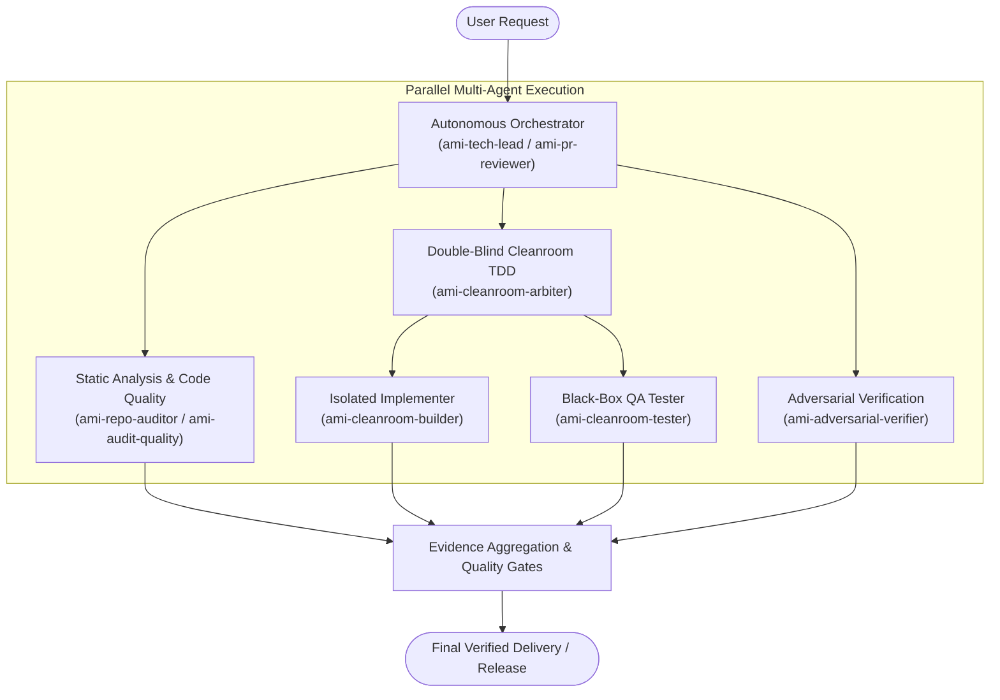

<p align="center">
  
</p>

# Amiga IA - Autonomous Agentic Suite & Declarative Skills

[English](README.md) | [Español](README.es.md)

[](https://www.npmjs.com/package/@anacatavc/amiga-ia)
[](https://deepmind.google/technologies/gemini/)
[](https://anthropic.com/)
[](https://openai.com/codex/)
[](benchmarks/README.md)
[](LICENSE)

> 🎶 Repo name inspo: [Amiga Mia - Los Prisioneros](https://www.youtube.com/watch?v=qPHaLk4-_Ew)  
> 🌐 Product website: [amiga-ia.ana-catalina.com](https://amiga-ia.ana-catalina.com/)

---

### 1. Project Description
**Amiga IA** is a comprehensive ecosystem of *autonomous subagents*, *stateless guardrail hooks*, and *portable declarative skills* designed to elevate AI coding assistants from passive command executors into proactive team collaborators. Engineered for **Antigravity (Gemini)**, **Claude Code**, and **OpenAI Codex**, Amiga IA provides a single source of truth for scalable AI capability management built on the **Agent Skills (Markdown + Lazy Loading)** standard.

With its architectural evolution spanning **v3.0.0 ("The Agentic Evolution")** to **v5.7.0**, Amiga IA delivers decentralized multi-skill orchestration, Double-Blind Cleanroom TDD (`ami-cleanroom-arbiter`), tri-ecosystem native translation, and an autonomous UI rapid prototyping and design-consistency suite (`ami-ui-builder`, `ami-prototype-ui`, `ami-audit-ui-consistency`) without requiring step-by-step human guidance.

#### 1.1 End-to-End Autonomous Workflow
Rather than requiring step-by-step human prompts, Amiga IA coordinates decentralized subagent teams through contract-first boundaries and automated arbitration:



### 2. Getting Started & Installation
The official and recommended setup method is installing Amiga IA globally via the NPM package registry:

```bash
# 1. Install globally from the NPM registry
npm install -g @anacatavc/amiga-ia

# 2. Launch the interactive CLI setup wizard
amiga-ia-setup

# 3. Verify health, hooks, and YAML frontmatter integrity
amiga-ia-setup doctor
```

> 💡 **Multi-Engine Hooks & Guardrails:** Claude Code supports automated pre-commit advisory reminders and security interdictions merged cleanly into `~/.claude/settings.json` (with automatic rollback backup at `~/.claude/settings.json.amiga-backup`). Google Antigravity natively executes its atomic planning pipeline and declarative guardrails via `rules/ami-rules.md`. OpenAI Codex supports non-blocking lifecycle hooks in `~/.codex/hooks.json`.

#### 2.1 Multi-Ecosystem Environments Configured
When running `amiga-ia-setup`, the CLI wizard populates your home directory with clean, isolated capability configurations:

```text
~/.claude/                          # Claude Code Global Configuration
├── skills/ami-*/SKILL.md           # Declarative Skills (24 directories)
├── agents/ami-*.md                 # Autonomous Subagents (14 profiles)
├── settings.json                   # Merged Hooks (PreToolUse, PostToolUse)
└── settings.json.amiga-backup      # Safe original settings backup

~/.gemini/config/                   # Antigravity (Gemini) Global Configuration
├── skills/ami-*/SKILL.md           # Declarative Skills (24 directories)
├── agents/ami-*.md                 # Autonomous Subagents (14 profiles)
└── rules/ami-rules.md              # Declarative Operational Rules

~/.agents/skills/                   # Codex Global Skills (24 directories)
~/.codex/                           # Codex Global Configuration
├── agents/ami-*.toml               # Custom Subagents in TOML format (14 profiles)
├── AGENTS.md                       # Merged Behavioral Rules (Optional)
└── hooks.json                      # Optional Lifecycle Hooks
```

#### 2.2 Uninstallation
To cleanly detach Amiga IA from your AI coding environments:
1. Run `amiga-ia-setup` and select option `u` (Uninstall) to cleanly remove all copied skills, agents, rules, and hook injections from your settings.
2. Run `npm uninstall -g @anacatavc/amiga-ia` to purge the CLI package from your system.

### 3. Technologies & Architectural Innovations
* **Agent Skills (XML + Markdown Lazy Loading):** A token-efficient architecture where an index of available tools is compiled into the system prompt, allowing AI models to open and consume imperative skill instructions only when actively required.
* **Multi-Skill Parallel Orchestration (ADR-002):** Decentralized subagent profiles (such as `ami-pr-reviewer`, `ami-doc-architect`, and `ami-repo-auditor`) coordinate parallel worker threads to scan codebase technical debt, verify pre-push consistency, and review code concurrently.
* **Double-Blind Cleanroom TDD Triad (ADR-012, ADR-017):** Decoupled implementer (`ami-cleanroom-builder`) and QA tester (`ami-cleanroom-tester`) subagents mediated by `ami-cleanroom-arbiter` operating strictly across frozen interface contracts (`docs/contracts/`), eliminating test overfitting and confirmation bias.
* **Tri-Ecosystem Distribution & Semantic Compiler (ADR-014, ADR-015, ADR-016):** Transforms canonical Markdown sources into platform-native formats across Anthropic Claude Code (`~/.claude/`), Google Antigravity (`~/.gemini/config/`), and OpenAI Codex (`~/.agents/` & `~/.codex/`), compiling native TOML subagent manifests and performing dynamic path expansion (`__AMIGA_CODEX_SKILLS_DIR__`).
* **Dual-Mode Code Review & Adversarial Falsification (ADR-006, ADR-013):** Proactive adversarial auditing (`ami-adversarial-verifier`) evaluating PRs through dual review modes (Static Code Review vs. Full Dynamic Review with test execution) and 5-dimension blind-spot probes to eliminate false positives.
* **Autonomous UI Prototyping & Consistency Auditing (ADR-018):** Offloads verbose layout markup to `ami-ui-builder`, scaffolding self-contained HTML5/Tailwind living visual specifications (`docs/mockups/`) and auditing design system token adherence across Web, Desktop, and Mobile.
* **Zero-Overhead Stateless Execution (ADR-003):** Background security hooks are optimized for token economy and zero memory pollution, operating seamlessly across native Bash, Windows PowerShell, and zero-dependency Node.js execution engines.
* **Compact System Prompt & Unified Hook Optimization (ADR-004):** Refactored Universal Adapter XML generation to use root-relative compact attributes and migrated inline PowerShell and Bash commands to external runtime scripts (`hooks/scripts/ami-hooks.ps1` & `ami-hooks.sh`). This achieved a verified **36.3% reduction (-1,211 tokens/turn)** in recurring System Prompt overhead (dropping from 3,335 to 2,124 tokens/turn), faster LLM inference, and zero hook deduplication errors.
* **Interactive CLI Wizard (`amiga-ia-setup`):** An automated setup, migration, and diagnostic suite built in Node.js that cleanly installs skills, merges configurations into AI user settings, and dynamically checks system health.

### 4. Empirical Benchmarks & Verification
Amiga IA validates its core architectural claims via a 100% deterministic, offline agentic benchmark suite (`benchmarks/`):

```bash
# Run the complete agentic benchmark suite
npm run benchmark

# Run individual benchmarks
npm run benchmark:tokens    # Validates -44.75% context reduction (ADR-004)
npm run benchmark:audit     # Validates defect detection (100% precision & recall)
npm run benchmark:cleanroom # Validates Cleanroom TDD (0% confirmation bias)
```

| Benchmark Experiment | Focus / Claim | Empirical Result | Quality Gate | Status |
|---|---|---|---|---|
| **System Prompt Token Overhead** | Context footprint reduction per turn (ADR-004) | **-2,973 tokens saved (-44.75%)** | $\ge 35.0\%$ reduction | **PASSED** |
| **Repository Audit Defect Detection** | Precision, recall & false positive resilience | **100% Precision, 100% Recall ($F_1 = 1.00$)** | $F_1 \ge 0.85$ | **PASSED** |
| **Cleanroom TDD Isolation** | Confirmation bias & escaped defects (ADR-012) | **0% confirmation bias, 0 escaped defects** | 0 escaped defects | **PASSED** |

> 📊 Detailed methodology, evaluation contracts, and raw metrics are documented in [benchmarks/README.md](benchmarks/README.md) and the generated [BENCHMARK_REPORT.md](benchmarks/results/BENCHMARK_REPORT.md).

### 5. Flagship Capabilities & Agent Profiles
Amiga IA encompasses **38 built-in capabilities** (14 autonomous subagents and 24 declarative skills) strictly utilizing the `ami-` namespace prefix to prevent collisions with external ecosystems.

The matrix below highlights the core **flagship agents and skills** that drive the primary autonomous workflows:

| Component | Type | Primary Role & Responsibility |
|---|---|---|
| **ami-cleanroom-arbiter** | Agent | Master Cleanroom TDD Arbiter. Freezes formal interface contracts (`docs/contracts/`), dispatches isolated builder and tester subagents, executes test harnesses, and adjudicates failures. |
| **ami-pr-reviewer** | Agent | Master review orchestrator evaluating PRs via dual review modes (static review vs full dynamic review with tests) and adversarial falsification audits. |
| **ami-repo-auditor** | Agent | Master audit orchestrator evaluating codebase technical debt, dependency hygiene, and security vulnerabilities across modules concurrently. |
| **ami-tech-lead** | Agent | Master Project Planning & Architecture Orchestrator. Evaluates repository health, plans features, and coordinates architectural blueprints. |
| **ami-ui-builder** | Agent | Master UI, UX, and prototype specialist. Builds interactive HTML5/Tailwind mockups, standalone prototypes, and living visual specs without context pollution. |
| **ami-push-assistant** | Agent | Pre-push orchestrator conducting baseline quality checks, scanning for leaked secrets/tokens, and verifying test suites before remote git push. |
| **ami-orchestrate-cleanroom** | Skill | Double-Blind Cleanroom orchestration workflow coordinating isolated implementer and black-box test generator subagents over frozen contracts. |
| **ami-review-self-pr** | Skill | Stringent Senior Engineer local review workflow with 5-dimension blind-spot probes and automated test remediation loops. |
| **ami-audit-quality** | Skill | Deep code inspection workflow for modular maintainability, security flaws, schema consistency, and structural soundness. |
| **ami-design-ux** | Skill | Master UX architect designing interaction models, user journeys, the 5 essential states, and microcopy (`docs/ux/`). |
| **ami-prototype-ui** | Skill | Rapid scaffolding of self-contained, interactive HTML5 and Tailwind CSS UI mockups and screen prototypes (`docs/mockups/`). |

> 📚 **Complete Catalog:** For the exhaustive reference, detailed schemas, and domain categorization of all 38 autonomous agents and declarative skills, see the [Full Capabilities Catalog](docs/catalog.md) ([Español](docs/catalog.es.md)).

### 6. Key Learnings (Developer Takeaways)
Building and scaling Amiga IA through its evolution into a fully agentic ecosystem yielded significant engineering lessons:
* **Agentic vs. Passive Prompting:** Traditional step-by-step imperative scripts break down as codebases scale. Transitioning to autonomous subagent profiles that reason about project goals, discover local tools, and delegate worker threads in parallel proved dramatically more robust and scalable than monolithic prompt engineering.
* **Cleanroom Isolation vs. Confirmation Bias:** Single-agent test generation inevitably suffers from confirmation bias—the same model that wrote the code writes tests shaped by its own assumptions. Splitting the workflow into isolated subagents that communicate strictly through immutable interface contracts (Cleanroom TDD) surfaced edge cases and architectural ambiguities before code touched production.
* **Token Economy & Statelessness:** Early iterations utilized persistent background caching to store local session summaries. Iterative analysis revealed that retaining stale context across session restarts degraded LLM inference speed and inflated token consumption. Depreciating session state caching in favor of stateless, on-demand reactive inspections (ADR-003) drastically boosted system responsiveness and precision.
* **Mitigating the Silent Recurring Token Tax:** Dynamic tool catalogs injected into AI System Prompts impose a severe compounding cost over extended conversational sessions. Utilizing attribute-driven root-relative indexing instead of verbose XML wrapper hierarchies eradicated massive static redundancy (ADR-004). Furthermore, transitioning from complex inline shell expressions to standardized external runtime invocations prevented OS shell escaping gotchas and eliminated string-matching deduplication failures across platforms.
* **Cross-Platform Path Resolution & Runtime Neutralization:** Deploying declarative skills across diverse AI assistant runtimes requires strict path normalization. Absolute paths in shared packages cause environmental collisions; abstracting local directories into runtime-interpolated placeholders resolved Windows/Linux filesystem discrepancies and prevented regex replacement side effects during installation.
* **Cross-Platform & Multi-Engine Unification:** Achieving 100% cross-compatibility between disparate AI runtimes (Antigravity, Claude Code, and OpenAI Codex) and distinct operating systems (Linux/macOS Bash vs. Windows PowerShell) required abstracting hook logic into universal runtime scripts and enforcing strict capability translation across native formats.

### 7. Repository Structure
```text
amiga-ia/
├── package.json             # NPM Package registry definition & Single Source of Truth
├── bin/setup.js             # Interactive CLI setup wizard & doctor tool
├── adapters/                # Universal XML catalog compiler (universal_adapter.js)
├── agents/                  # Autonomous Subagent profiles in Markdown (ami-*.md)
├── skills/                  # Canonical declarative Markdown skills (ami-*/SKILL.md)
├── benchmarks/              # Empirical agentic benchmark suite & evaluation contracts
│   ├── contracts/           # Frozen benchmark evaluation contracts
│   ├── token-overhead/      # Context compression benchmark (ADR-004)
│   ├── repo-audit/          # Multi-agent defect detection benchmark
│   ├── cleanroom-tdd/       # Double-Blind Cleanroom vs Single-Agent benchmark
│   └── results/             # Raw metrics & generated BENCHMARK_REPORT.md
├── docs/                    # Persistent agent memory & documentation tree
│   ├── catalog.md           # Full Capabilities Catalog (38 agents & skills)
│   ├── adr/                 # Architectural Decision Records (ADRs 001-021)
│   ├── architecture/        # Deep structural & adapter engineering guides
│   ├── contracts/           # Formal Cleanroom TDD interface contracts
│   ├── ux/                  # Living UX specifications & interaction state matrices
│   ├── mockups/             # Living UI specifications (HTML5 + Tailwind CSS)
│   └── learning/            # Captured session learnings and iterative patterns
├── codex/                   # Generated Codex-native skill and subagent files
├── hooks/                   # Cross-platform guardrail hooks (.js wrappers, .ps1, .sh)
├── hooks.json               # Claude Code native hooks configuration (Bash engine)
└── hooks-pwsh.json          # Claude Code native hooks configuration (PowerShell engine)
```

### 8. Extending the Ecosystem
* **Mandatory Naming Convention (`ami-` prefix):** All custom skills and agent profiles MUST begin with `ami-` (e.g., `ami-db-migrator`). This ensures clean namespace separation and protects your custom tools from external conflicts.
* **Adding a New Skill:** Create a folder at `skills/ami-<name>/` containing a `SKILL.md` instruction file configured with standard YAML frontmatter.
* **Adding a New Agent:** Create an autonomous persona file at `agents/ami-<name>.md` detailing behavior rules, skill invocation authorizations, and coordination directives.

---

## License

This project is licensed under the MIT License. See [LICENSE](LICENSE) for details.
